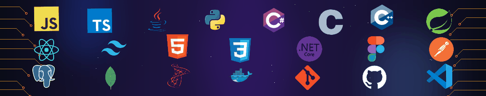

  

<h1 align="center">Ho Le Thien An</h1>

  <strong>Backend-Focused Fullstack Builder</strong>

  

  
  
  
  

  
  

##  About Me

I am a third-year Software Engineering student at FPT University Ho Chi Minh City, building a solid backend foundation with Spring Boot and .NET while growing toward fullstack engineering.

My approach is simple: think clearly, solve real problems, and turn ideas into practical results. Right now I am focused on backend system design, with a taste of hardware and architecture on the side. Alongside code, I am learning Business Analysis (BA) and several foreign languages, so I can build the right thing and talk about it with more people.

Fun fact: I play piano so much that my hands decided to start playing on their own 💀 (Parkinson...)

<table align="center">
  <tr>
    <td width="33%" valign="top">
      <strong>Now</strong>  
      Going deep on Spring Boot and .NET for solid backend architecture, using AI assistants and LLMs as a pair-programming partner, and studying BA to understand the problem before writing the solution.
    </td>
    <td width="33%" valign="top">
      <strong>Next</strong>  
      Digging further into React and TypeScript so the frontend feels as deliberate as the backend, while keeping up with learning more foreign languages.
    </td>
    <td width="33%" valign="top">
      <strong>Long Game</strong>  
      Becoming a fullstack developer who can own a product end to end, from requirements and APIs to a clean, usable interface.
    </td>
  </tr>
</table>

##  Current Focus

Projects I am working on right now, from a multi-role management system to algorithms, robotics and AI.

<table>
  <tr>
    <td width="50%" valign="top">
      <strong>🏟️ <a href="https://github.com/SWP391-SportHub-Group4/sports-center-management-system">SportHub</a></strong>  
      Multi-sport center management system for the course. Covers five roles (Admin, Manager, Coach, Member, Receptionist), membership and gym check-in, class enrollment with seat reservation, court rental and scheduling, VNPay-QR payment combined with a points wallet, reports, and an AI assistant.
    </td>
    <td width="50%" valign="top">
      <strong>🎵 <a href="https://github.com/MusicStreamingPlaylistManager/MusicStreamingPlaylistManager">MusicStreamingPlaylistManager</a></strong>  
      A Spotify-like music streaming app built around data structures and algorithms. Implements custom dynamic arrays, doubly linked lists, a history stack, merge sort and a song search engine in Java, with servlets for auth, playlists, favorites and an audio player. Deployed on <a href="https://music-streaming-playlist-manager.vercel.app">Vercel</a>.
    </td>
  </tr>
  <tr>
    <td width="50%" valign="top">
      <strong>🏎️ <a href="https://github.com/Chonf-pkz/Jetson-Nano">Jetson AI Racer</a></strong> (ongoing)  
      A self-driving JetRacer model car on Jetson Nano with a LiDAR, running ROS Melodic and SLAM (GMapping) visualized in RViz. A compact PilotNet-style network predicts the steering angle from the camera, exported to ONNX for the Jetson. I wrote the step-by-step guide for starting the car, LiDAR and SLAM, and for fixing duplicate ROS nodes.
    </td>
    <td width="50%" valign="top">
      <strong>🧭 <a href="https://github.com/stella30th/GLOBAL_HACKATHON">Global Hackathon: Skill Path</a></strong>  
      A one-page app built with Spring Boot, React (Vite) and Google Gemini. Upload a CV and a target role, then get a staged learning path with skill gaps, a skill graph, and a CV review. It maps skills to the SFIA 9 taxonomy, orders them with a prerequisite graph, and cites real learning resources through BM25 retrieval (RAG).
    </td>
  </tr>
</table>

##  Tech Stack

The tools I use most while building toward stronger backend depth and cleaner frontend work.

**Languages**

  

**Frontend**

  

**Backend & Frameworks**

  

**Databases**

  
  
  

**DevOps & Tools**

  

##  GitHub Stats

   
   

##  Connect

I am open to internship opportunities and conversations with developers, teams, and people who enjoy building useful things.

<table align="center">
  <tr>
    <td width="50%" valign="top">
      <strong>Open to work</strong>  
      Internship opportunities, collaborative projects, and practical engineering conversations are always welcome.
    </td>
    <td width="50%" valign="top">
      <strong>Preferred topics</strong>  
      Backend systems, Spring Boot and .NET, and everything that helps ship better software.
    </td>
  </tr>
</table>

  

  
  
  

  <a href="https://stella30th.github.io/stella30th/" target="_blank" title="Click to launch the interactive 2D physics sandbox!">
    <picture>
      <source type="image/webp" srcset="./assets/footer-physics.webp">
      
    </picture>
  </a>

  Glad to have you here. Explore my projects, follow my journey, and let's connect! 🚀

